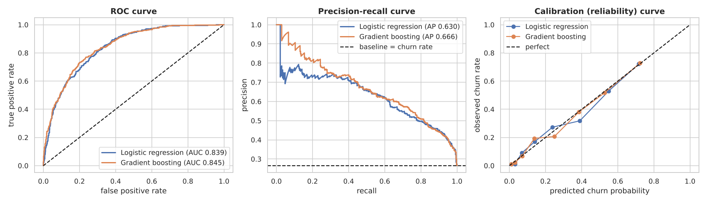
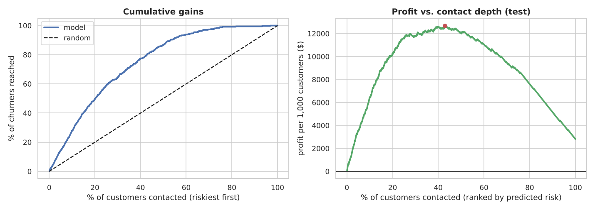
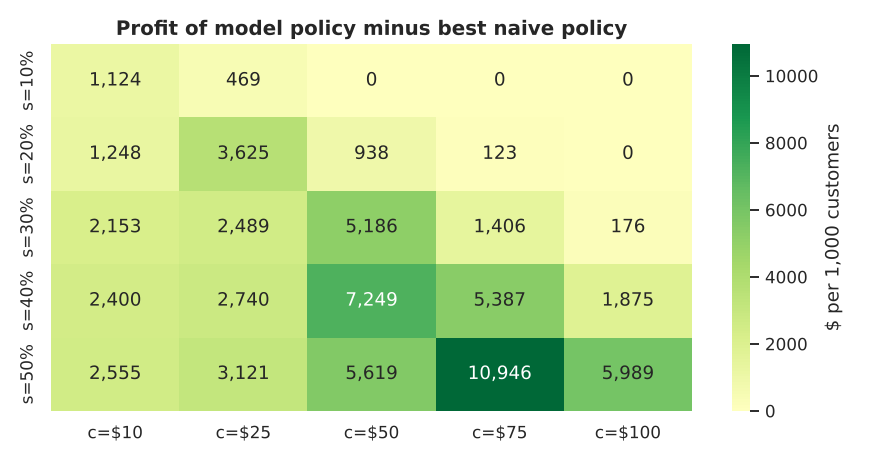

# 📉 Telco Customer Churn: Prediction and Retention-Campaign ROI

   

> **Not just "predict churn": decide *who* to spend retention budget on, and prove it makes money.**
> Public benchmark dataset (IBM Telco sample, 7,043 customers of a fictional telco) → leakage-aware modelling → honest validation → calibration → expected-profit targeting with bootstrap confidence intervals and sensitivity analysis.
> 📓 **[Open the notebook](notebooks/04_telco_churn_prediction_roi.ipynb)**

## 🎯 Business problem
About 1 in 4 customers (26.5%) churn. A retention offer costs money and is wasted on customers who would have stayed anyway.
**Which customers should receive the offer, and does targeting beat contacting everyone?**

## 🔬 What makes this more than a "churn classifier"
| Practice | How it is done here |
|---|---|
| Messy benchmark data | 11 blank `TotalCharges` traced to brand-new customers (tenure 0) and filled with 0, not a mean |
| Leakage and fairness thought | ID dropped; redundant `TotalCharges` dropped (r > 0.99 with tenure x monthly charge); `gender` excluded on purpose |
| Honest validation | Stratified split once; all tuning by 5-fold CV on **train only**; test set touched once |
| Right metrics | ROC-AUC **and** PR-AUC (class imbalance), Brier score, calibration curve |
| Model choice rule fixed in advance | Prefer the simpler, interpretable model unless boosting wins by more than 0.005 CV AUC |
| Interpretation | Odds ratios + permutation importance on the test set |
| Decision, not just a score | Expected profit = P(churn) x success rate x customer value − offer cost; contact only if positive |
| Uncertainty | 2,000-sample bootstrap of the test set for 95% intervals |
| Stress test | Sensitivity grid over offer success rate and cost; same decision rule with the other model |

## 📊 Results (held-out test set, 1,409 customers)
| | Logistic regression | Gradient boosting | Baseline |
|---|---|---|---|
| ROC-AUC | 0.839 | 0.845 | 0.500 |
| PR-AUC | 0.630 | 0.666 | 0.265 |
| Brier score | 0.139 | 0.135 | 0.195 |

Boosting is only marginally better; the CV gap sat right at the pre-set threshold, so the interpretable logistic model was kept.
Probabilities are well calibrated (curve near the diagonal), which the profit calculation requires.

**Business impact** (assumptions: offer costs USD 25, saves 30% of would-be churners, 40% margin, 12-month value):

| Policy | Customers contacted | Profit per 1,000 customers |
|---|---|---|
| Do nothing | 0% | USD 0 |
| Contact everyone | 100% | USD 2,814 |
| Rule: month-to-month customers | 55% | USD 10,116 |
| **Model: expected-profit rule** | **39%** | **USD 12,605** |

The model policy beats the best naive policy by about **USD 2,500 per 1,000 customers (95% bootstrap CI: 1,589 to 3,487)** while contacting fewer people.
The riskiest 20% of customers contain 50% of all churners.





## 🔎 Key insights
- **Month-to-month customers are 55% of the base but 89% of churners**; customers in their first 6 months churn at 53%.
- The riskiest 10% of customers are all month-to-month, 99% fibre-optic, with a median tenure of 4 months, and 74% of them actually churned.
- The campaign only pays off if the offer success rate is high enough. In the sensitivity grid, several low-success or high-cost scenarios give zero profit (the rule correctly contacts nobody). **Measuring that success rate with an A/B test matters more than a fancier model.**

## ⚠️ Limitations (be ready to say these in an interview)
- Single snapshot: predicts *who* churns, not *when* (survival analysis would add timing).
- The offer success rate, cost and margin are **assumptions**. Predicting churn is not the same as predicting who is *persuadable*; that needs uplift modelling on experiment data.
- Associations are not causal (e.g. fibre customers may churn because of price or competitors).
- `SeniorCitizen` is kept as a feature but age-based targeting should be reviewed for compliance.

## 🗂️ Project structure
```
├── data/telco_churn.csv                 # public IBM sample dataset
├── notebooks/04_telco_churn_prediction_roi.ipynb
├── images/
├── src/download_data.py                 # re-downloads the dataset
└── requirements.txt
```

## ▶️ Run it yourself
```bash
git clone https://github.com/singhji777/telco-churn-prediction-roi.git
cd telco-churn-prediction-roi
pip install -r requirements.txt
python src/download_data.py          # optional: dataset is already included
jupyter notebook notebooks/04_telco_churn_prediction_roi.ipynb
```

## 📚 Data source
Note: this is a sample dataset published by IBM (a fictional company), widely used for teaching, so treat the dollar figures as an illustration of method, not a real P&L.

IBM sample dataset "Telco Customer Churn" (publicly available in IBM's GitHub repository `IBM/telco-customer-churn-on-icp4d`). Please check the source repository for its usage terms.

## 👤 Author
**Aditya Singh** · [GitHub](https://github.com/singhji777)
